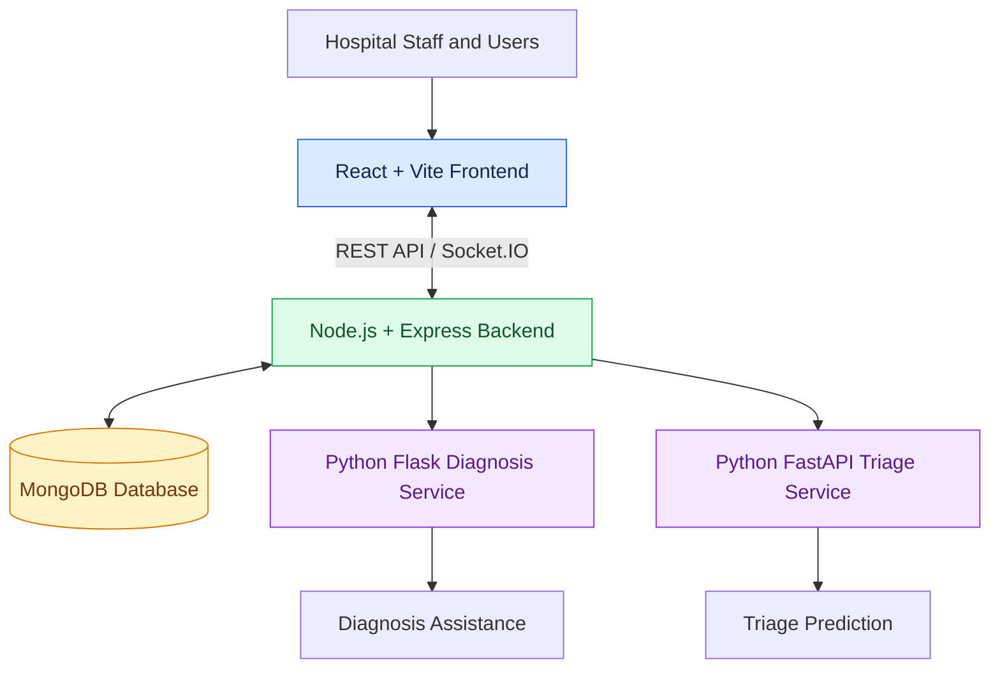

# 🏥 ApexHMS - AI-Powered Hospital Management System

**Smarter Hospital Workflows · Connected Care · AI-Assisted Triage**

ApexHMS is a full-stack hospital management platform designed to streamline hospital operations through patient management, doctor workflows, appointment scheduling, laboratory records, prescriptions, real-time communication, and AI-assisted healthcare utilities.

<p align="center">
  
  
  
  
  
  
</p>

---

## 📑 Table of Contents

- [Overview](#-overview)
- [Key Features](#-key-features)
- [System Architecture](#-system-architecture)
- [Technology Stack](#-technology-stack)
- [Getting Started](#-getting-started)
- [API Overview](#-api-overview)
- [Project Structure](#-project-structure)
- [Security and Privacy](#-security-and-privacy)
- [Future Enhancements](#-future-enhancements)
- [Contributing](#-contributing)
- [Author](#-author)

---

## 📌 Overview

Healthcare facilities need reliable systems to manage patient information, appointments, prescriptions, and clinical workflows efficiently.

**ApexHMS** explores how a modular full-stack application can bring these workflows together while integrating independent AI services for diagnosis assistance and patient triage.

The project combines a modern React frontend, a Node.js and Express backend, MongoDB persistence, real-time communication through Socket.IO, and Python-based AI services.

### 🎯 Project Goals

- Digitize essential hospital management workflows.
- Organize patient and doctor information.
- Simplify appointment and prescription management.
- Support laboratory record management.
- Enable real-time application communication.
- Integrate machine-learning services into a full-stack application.
- Demonstrate modular software architecture and API integration.

## ✨ Key Features

### 🧑‍⚕️ Hospital Management

- **Patient Management** — organize patient profiles and related information.
- **Doctor Management** — manage doctor information and associated workflows.
- **Appointment Management** — support appointment creation and management.
- **Prescription Management** — maintain prescription-related information.
- **Laboratory Management** — organize laboratory tests and records.
- **Administrative Workflows** — provide dedicated backend routes for administrative operations.

### 🔐 Authentication and Security

- JWT-based authentication.
- Password hashing using `bcryptjs`.
- Authentication middleware for protected routes.
- Environment-based configuration for sensitive values.
- Modular backend routes and middleware.

### ⚡ Real-Time Communication

- Socket.IO integration for real-time client-server communication.
- Event-based communication between application components.
- Doctor- and patient-specific communication rooms to support real-time features.

### 🤖 AI-Assisted Healthcare

#### 1. Diagnosis Assistance

A Python Flask service processes clinical notes and returns possible-condition predictions with associated confidence values.

The current diagnosis engine is a lightweight prototype rather than a clinically validated diagnostic system.

#### 2. Intelligent Patient Triage

A dedicated FastAPI service accepts patient information, symptoms, pain levels, and vital signs to predict a triage category and score using machine-learning artifacts.

This demonstrates how an independent ML inference service can integrate with a larger healthcare application.

> **Important:** AI predictions are intended for educational and demonstration purposes. They must not be used as a substitute for qualified medical professionals or validated clinical decision-making systems.

---

## 🏗️ System Architecture

ApexHMS separates the user interface, backend logic, database, and AI services into distinct components.



### Architecture Components

| Component | Responsibility |
|---|---|
| Frontend | User interface, navigation, and API communication |
| Backend | Business logic, authentication, API routes, and Socket.IO |
| MongoDB | Persistent application data |
| Diagnosis Service | Clinical-note processing and prototype predictions |
| Triage Service | ML-based triage inference |
| Socket.IO | Real-time event communication |

---

## 🛠️ Technology Stack

| Layer | Technologies |
|---|---|
| Frontend | React, Vite, React Router, Tailwind CSS |
| UI Utilities | Axios, Lucide React, Recharts |
| Backend | Node.js, Express.js |
| Database | MongoDB, Mongoose |
| Authentication | JSON Web Tokens, bcryptjs |
| Real-Time Communication | Socket.IO |
| Diagnosis Service | Python, Flask |
| Triage Service | Python, FastAPI, machine-learning artifacts |
| Development Tools | Git, npm, ESLint |

---

## 🚀 Getting Started

Follow these instructions to set up the application locally.

### Prerequisites

Ensure that the following tools are installed:

- [Git](https://git-scm.com/)
- [Node.js and npm](https://nodejs.org/)
- [Python 3](https://www.python.org/)
- [MongoDB Community Server](https://www.mongodb.com/try/download/community)

### 1. Clone the Repository

```bash
git clone https://github.com/Piyush-Gitkhg10/ApexHMS.git
cd ApexHMS
```

### 2. Configure the Backend

Navigate to the backend directory:

```bash
cd backend
npm install
```

Create a `.env` file inside the `backend` directory:

```env
PORT=5000
MONGO_URI=mongodb://127.0.0.1:27017/apexhms
JWT_SECRET=replace_with_a_secure_random_secret
```

Replace the example JWT secret with a strong, randomly generated value. Do not commit your `.env` file.

Start the backend:

```bash
npm run dev
```

If the development script is unavailable, use the start script defined in the backend's `package.json`:

```bash
npm start
```

The backend is expected to run at `http://localhost:5000`.

### 3. Configure the Frontend

Open a new terminal from the repository root:

```bash
cd frontend
npm install
npm run dev
```

Open the URL displayed by Vite, typically:

`http://localhost:5173`

To build the frontend for production:

```bash
npm run build
```

### 4. Start the AI Diagnosis Service

Open another terminal:

```bash
cd ai-engine
```

Install the service dependencies:

```bash
pip install -r requirements.txt
```

Start the Flask service:

```bash
python app.py
```

The diagnosis service is expected to run at `http://localhost:5001`.

### 5. Start the AI Triage Service

Open another terminal:

```bash
cd ai-triage-service
```

If the service includes a `requirements.txt` file, install its dependencies:

```bash
pip install -r requirements.txt
```

Start the FastAPI service:

```bash
uvicorn main:app --reload --port 8000
```

The triage service is expected to run at `http://localhost:8000`.

If interactive API documentation is enabled, visit:

`http://localhost:8000/docs`

### 6. Run All Services

Ensure that the database and required application services are running:

1. MongoDB
2. Backend API
3. Frontend
4. AI diagnosis service
5. AI triage service

Confirm that the configured service URLs, environment variables, and ports match your local project configuration.

> **Setup note:** The commands above assume the directory names and entry points shown in this guide. Check each service's `package.json`, Python dependency files, and source code if your local setup differs.

---

## 🔌 API Overview

The backend organizes functionality into feature-specific route groups.

| Endpoint Prefix | Purpose |
|---|---|
| `/api/auth` | Authentication |
| `/api/patients` | Patient management |
| `/api/doctors` | Doctor management |
| `/api/appointments` | Appointment management |
| `/api/lab-tests` | Laboratory workflows |
| `/api/prescriptions` | Prescription management |
| `/api/admin` | Administrative operations |
| `/api/ai` | AI integration |

The route prefixes above are a high-level overview. Refer to the backend source code for exact paths, HTTP methods, and authorization requirements.

### Diagnosis Assistance API

**Endpoint:** `POST /predict-diagnosis`

Example request:

```json
{
  "notes": "Patient reports fever, cough and chills"
}
```

Illustrative response:

```json
{
  "status": "success",
  "predictions": [
    {
      "condition": "Example condition",
      "confidence": 88
    }
  ]
}
```

The example shows a possible response structure and does not represent a guaranteed prediction.

### Patient Triage API

The triage service provides a `/predict-triage` endpoint for patient information and triage prediction.

Illustrative response:

```json
{
  "triageLevel": "Urgent",
  "triageScore": 87.4
}
```

The actual request schema and response fields depend on the current service implementation.

---

## 📂 Project Structure

```text
ApexHMS/
├── frontend/           # React frontend
├── backend/            # Express backend and API routes
├── ai-engine/          # Flask diagnosis assistance service
├── ai-triage-service/  # FastAPI triage service
├── .gitignore
└── package.json
```

This is a simplified representation. Additional files and subdirectories may exist within each component.

---

## 🔒 Security and Privacy

ApexHMS demonstrates foundational application-security patterns. However, production healthcare deployments require comprehensive security, privacy, and compliance reviews.

Recommended considerations include:

- Enforce HTTPS/TLS for network communication.
- Implement role-based access control and least-privilege permissions.
- Validate and sanitize incoming requests.
- Use rate limiting and appropriate security headers.
- Store secrets securely and rotate them regularly.
- Protect database access and maintain reliable backups.
- Record audit trails for sensitive operations.
- Protect patient information and apply appropriate retention policies.
- Evaluate AI models for accuracy, bias, and reliability.
- Require qualified human oversight for clinical decisions.

**Never commit passwords, API keys, production credentials, or real patient information to the repository.**

---

## 👨‍💻 Author

**Piyush Kumar**

- GitHub: [@Piyush-Gitkhg10](https://github.com/Piyush-Gitkhg10)
- Repository: [ApexHMS](https://github.com/Piyush-Gitkhg10/ApexHMS)
